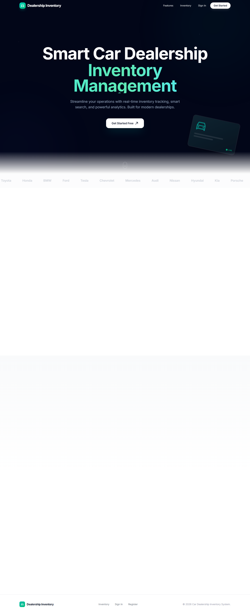
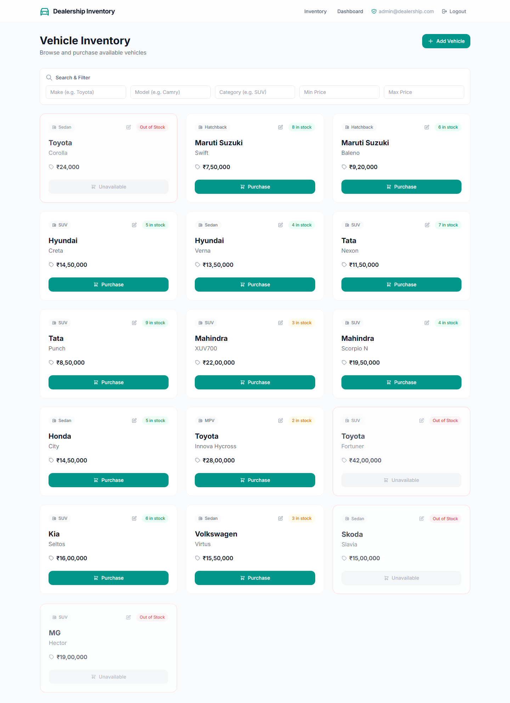
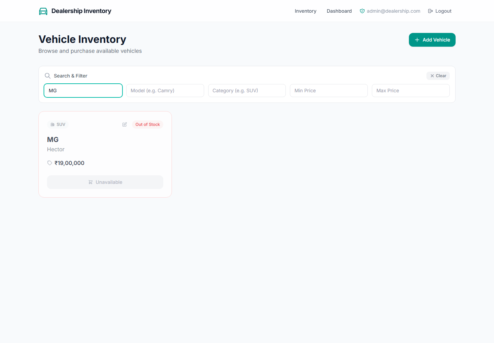
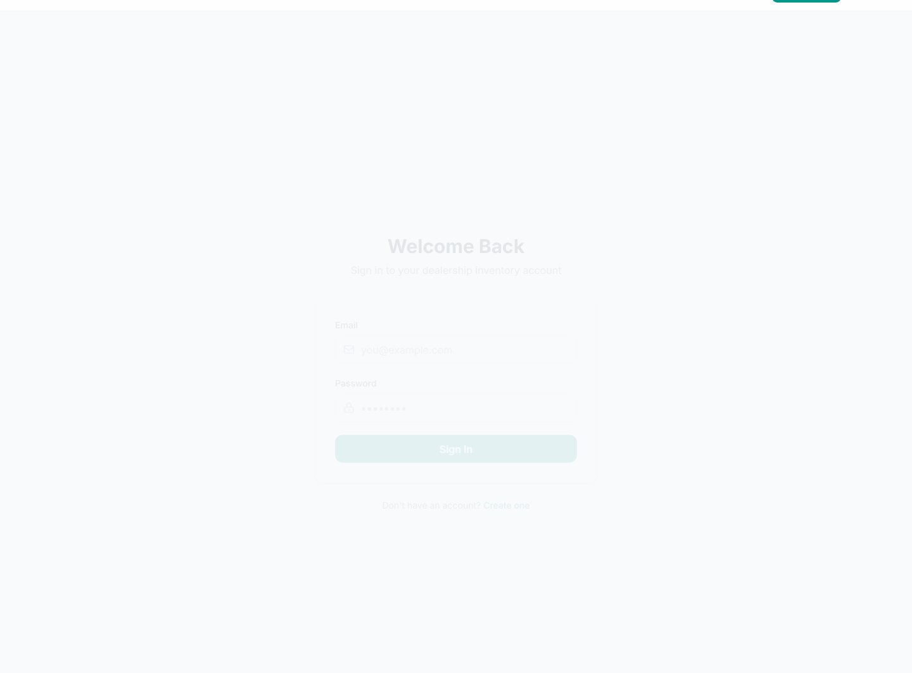
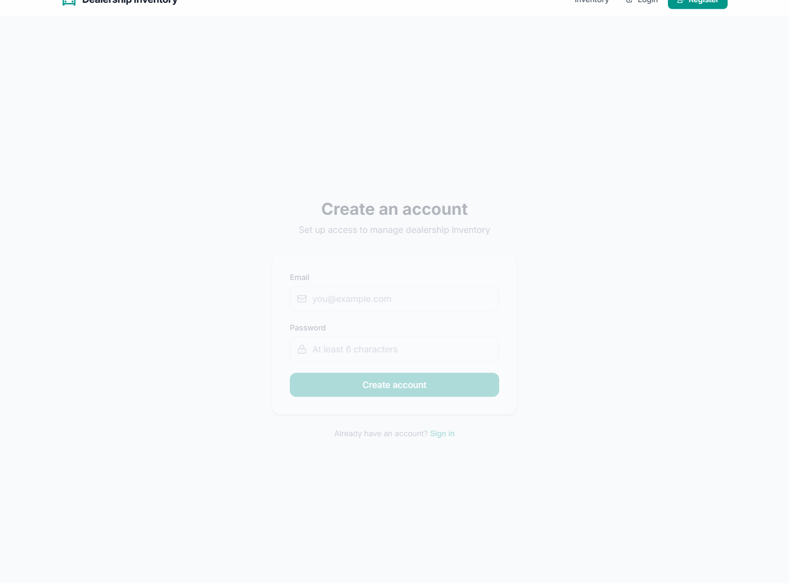
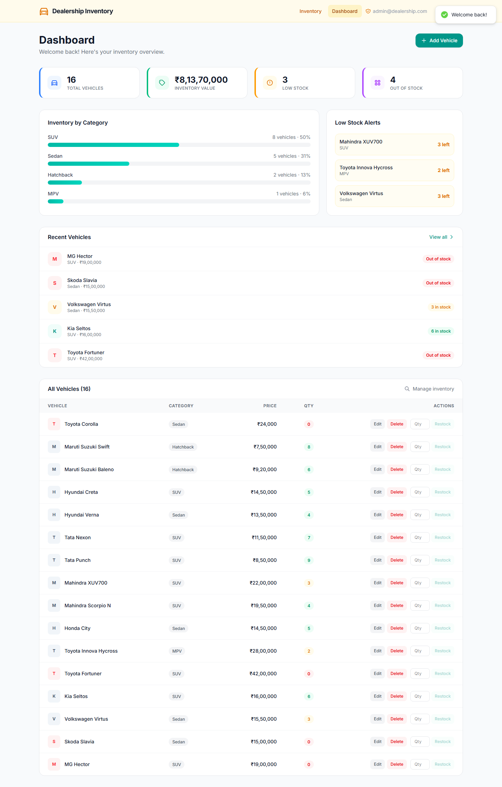
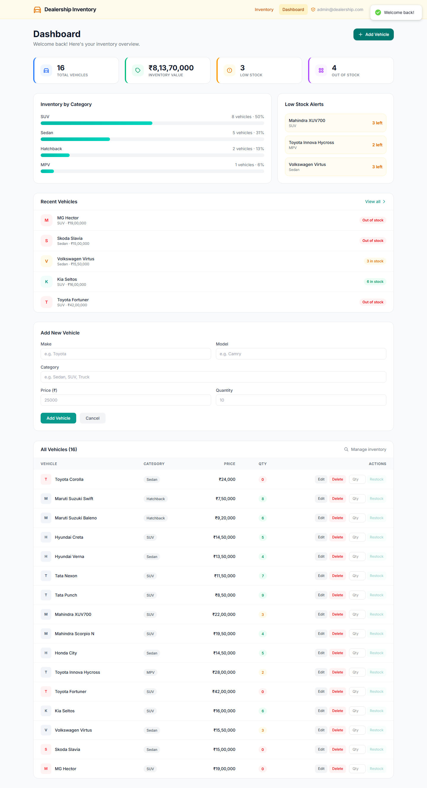

# Car Dealership Inventory Management System

A full-stack car dealership inventory management system featuring vehicle browsing, advanced search, secure purchasing, stock tracking, and role-based administration.

## Tech Stack

| Area | Technologies |
|---|---|
| Backend | Node.js 22.5+, TypeScript 5.9, Express 5, Prisma 6, SQLite, JWT, bcryptjs, Zod |
| Frontend | React 19, Vite 8, Tailwind CSS 4, React Router, Axios, Framer Motion, React Icons |
| Testing | Vitest 4, Supertest, React Testing Library, Playwright 1.64 |
| DevOps | Git and GitHub Actions CI for tests, linting, and builds |

## Getting Started

### Prerequisites

- Node.js 22.5 or newer
- npm
- Git

### Backend

```powershell
git clone https://github.com/ProfOP/Car-Dealership-Inventory-System.git
cd Car-Dealership-Inventory-System\backend
npm install
Copy-Item .env.example .env
npm run prisma:setup
npm run prisma:seed
npm run dev
```

The API listens on `http://localhost:8080`. Configure `DATABASE_URL`, `JWT_SECRET`, `PORT`, `FRONTEND_ORIGIN`, `ADMIN_EMAIL`, and `ADMIN_PASSWORD` in `.env`. The `.env.example` file contains safe placeholders; do not commit `.env`.

`prisma:setup` initializes the checked-in SQLite migration. The seed provisions the configured Admin account and adds 15 demonstration vehicles only when their make/model pair is missing. Existing vehicles, prices, quantities, users, and purchases are preserved. Running the seed repeatedly is safe.

### Frontend

```powershell
cd D:\car-dealership-inventory\frontend
npm install
npm run dev
```

Open [http://localhost:5173](http://localhost:5173). During local development, Vite proxies `/api` requests to the backend on port 8080. Set `VITE_API_URL` only when using a different API origin.

## Features

### Public Visitors

- Animated landing page and feature showcase
- Registration and login navigation

### Authenticated Users

- Browse 16 vehicles, including available and out-of-stock examples
- Search by make and model
- Filter by category and price range
- View prices formatted in Indian Rupees, such as `₹14,50,000`
- Purchase available vehicles with user-facing feedback
- View updated stock levels

### Admin Users

- Dashboard with inventory totals, value, category breakdown, low-stock alerts, and recent vehicles
- Add, update, and delete vehicles
- Restock inventory
- View the full inventory table and management actions

### Security and Reliability

- JWT authentication and bcrypt password hashing
- Role-based authorization for Admin mutations
- Zod request validation
- Persistent SQLite storage
- Atomic stock decrement to prevent negative inventory and overselling

## API Endpoints

| Method | Endpoint | Authentication | Description |
|---|---|---|---|
| POST | `/api/auth/register` | Public | Register a User account |
| POST | `/api/auth/login` | Public | Authenticate and issue a JWT |
| GET | `/api/vehicles` | User/Admin | List inventory |
| GET | `/api/vehicles/search` | User/Admin | Search by make, model, category, minimum price, and maximum price |
| GET | `/api/vehicles/:id` | User/Admin | Fetch one vehicle |
| POST | `/api/vehicles` | Admin | Create a vehicle |
| PUT | `/api/vehicles/:id` | Admin | Update a vehicle |
| DELETE | `/api/vehicles/:id` | Admin | Delete a vehicle |
| POST | `/api/vehicles/:id/purchase` | User/Admin | Purchase stock atomically |
| POST | `/api/vehicles/:id/restock` | Admin | Increase vehicle stock |

## Running Tests

Run these commands from the project root as shown:

```powershell
cd backend; npm test
cd backend; npm run test:integration
cd backend; npm run test:coverage
cd backend; npm run build
cd frontend; npm test
cd frontend; npm run lint
cd frontend; npm run build
cd frontend; npx playwright install chromium
cd frontend; npm run test:e2e
```

### Verified results

| Suite | Passed | Failed |
|---|---:|---:|
| Backend unit/security | 15 | 0 |
| Backend integration/concurrency | 11 | 0 |
| Frontend | 45 | 0 |
| Browser E2E | 8 | 0 |
| Total | 79 | 0 |

Measured backend coverage: **95.07% statements**, **86% branches**, **95% functions**, and **100% lines**.

Detailed evidence is available in [docs/test-report.md](docs/test-report.md), [docs/final-audit.md](docs/final-audit.md), and [docs/requirements-compliance.md](docs/requirements-compliance.md).

## Screenshots

These screenshots were captured from the running independent application using its demonstration inventory and local Admin account. They contain no passwords, tokens, or private data.

### Landing Page



### Vehicle Inventory



### Search and Filtering



### Login Page



### Registration Page



### Admin Dashboard



### Admin Add/Edit Vehicle



## Project Structure

```text
Car-Dealership-Inventory-System/
├── backend/
│   ├── prisma/              # Schema, migration, setup, and seed data
│   ├── src/                 # Express app, routes, services, repositories
│   ├── tests/               # Unit, integration, and concurrency tests
│   └── package.json
├── frontend/
│   ├── src/                 # React pages, components, API, and tests
│   ├── e2e/                 # Playwright browser scenarios
│   └── package.json
├── docs/                    # Test report, audit, and compliance matrix
├── screenshots/             # Genuine local application screenshots
├── .github/workflows/       # GitHub Actions quality workflow
├── README.md
├── PROMPTS.md
└── .gitignore
```

## My AI Usage

### Tools Used

- OpenAI Codex
- ChatGPT, where applicable

### How AI Was Used

AI assistance supported requirements analysis, reference-repository inspection, independent backend architecture planning, Prisma schema and API implementation, authentication and authorization work, vehicle management, atomic inventory operations, frontend/API compatibility, unit and integration testing, concurrency testing, Playwright scenarios, debugging, INR formatting, seed idempotency, documentation, and CI configuration.

Later fixes used verified test-first cycles where the available history supports them. AI-generated suggestions and code were reviewed, executed, and validated locally. Permitted frontend components and visual assets from the reference implementation were reused, while the backend was substantively reimplemented as a TypeScript/Express/Prisma service. The available history does not establish complete historical Red-Green-Refactor compliance for every feature.

## Test Report

See the full [test report](docs/test-report.md), [final audit](docs/final-audit.md), and [requirements compliance matrix](docs/requirements-compliance.md).

The frontend audit is clean. The backend retains three high Prisma CLI/config transitive advisories in the Prisma 6 toolchain; upgrading to Prisma 7 is a separately tested breaking-change task. No application secrets, local databases, or generated build artifacts are tracked.

## License and Attribution

No standalone license file is currently included in this repository. Existing attribution and assignment context are preserved in the project documentation and history. Review third-party library licenses before redistribution.
